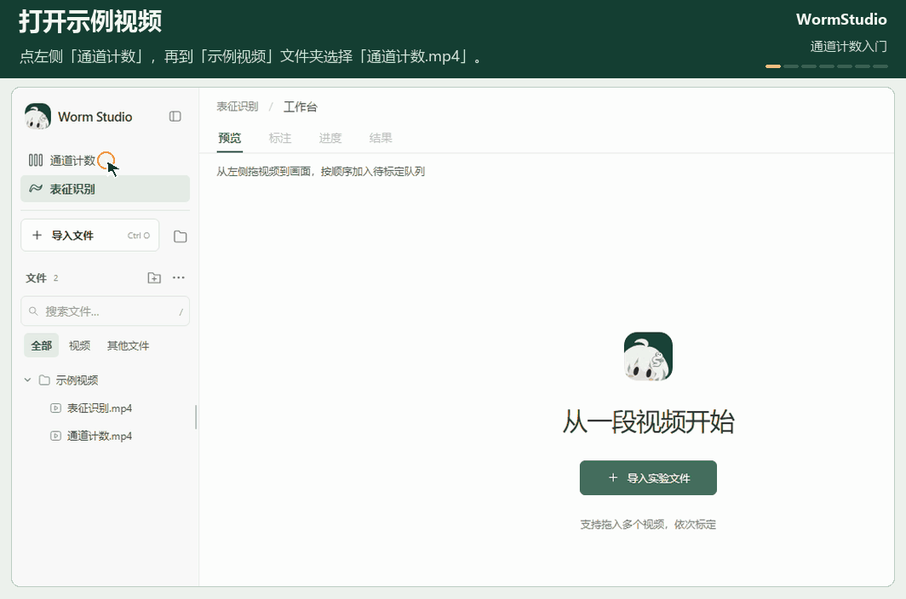
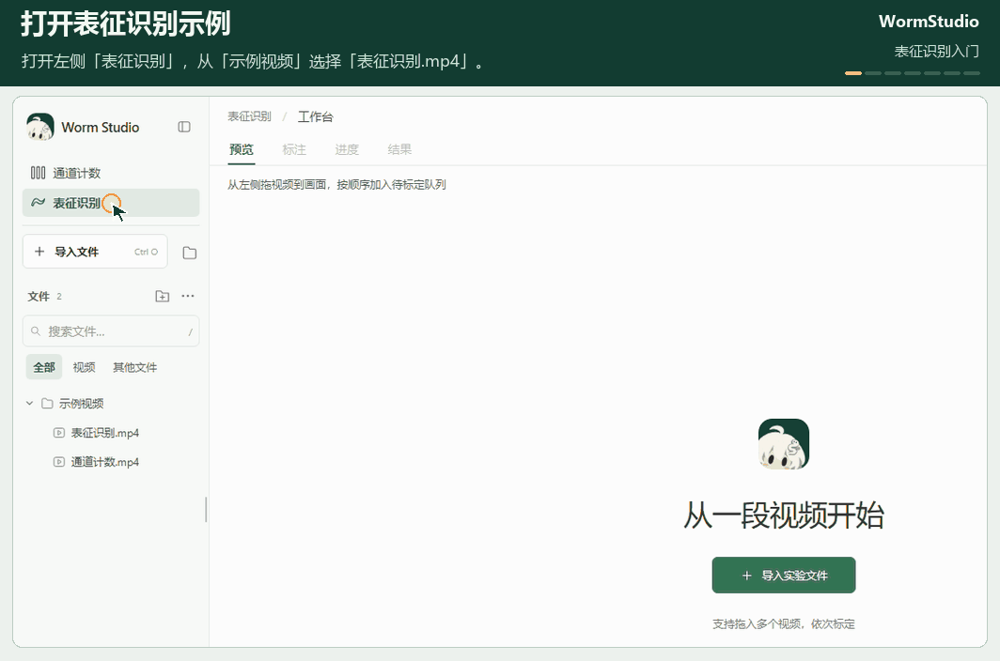

  

<h1 align="center">WormStudio</h1>

<em>🔬 在本机跟踪线虫，逐帧测量体态与运动</em>

  
  
  
  

  <strong><a href="https://github.com/WRtidE/WormStudio/releases/download/v2.1.0/WormStudio-Windows-x64.zip">下载 Windows 在线版</a></strong> ·
  <strong><a href="https://github.com/WRtidE/WormStudio/releases/download/v1.0.3/WormStudio-Mac-arm64.zip">下载 Mac 版</a></strong> ·
  <a href="#用练习视频完成第一次分析">第一次分析</a> ·
  <a href="docs/USER_GUIDE.md#windows-显卡加速检测">GPU 加速</a>

## 下载与启动

| 电脑 | 下载 | 第一次打开 |
| --- | --- | --- |
| Windows 64 位（x64） | [Windows v2.1.0 在线版，约 170 MB](https://github.com/WRtidE/WormStudio/releases/download/v2.1.0/WormStudio-Windows-x64.zip) | 右键 ZIP 选 **全部解压**，打开文件夹，双击 `WormStudio.exe`。 |
| Apple 芯片 Mac（macOS 14 及以上） | [Mac v1.0.3 离线版](https://github.com/WRtidE/WormStudio/releases/download/v1.0.3/WormStudio-Mac-arm64.zip) | 解压，将 `WormStudio.app` 拖入“应用程序”，按包内《先读我》选择 **准备并打开**。 |

Windows 首次启动需要联网。默认 CPU 组件约 1.12 GiB，建议预留 5 GiB 磁盘空间。下载中断后可继续，准备完成后可离线分析。[显卡加速说明](docs/USER_GUIDE.md#windows-显卡加速检测) · [版本与校验文件](https://github.com/WRtidE/WormStudio/releases/tag/v2.1.0)

## 用练习视频完成第一次分析

两张动图演示 Windows 版的操作。先在左侧选择项目，再从文件栏的 **示例视频** 文件夹打开对应的 16 帧短片。分析自己的视频时，可以直接把文件拖入工作台。

### 通道计数

打开 `通道计数.mp4`，拖动检测线，点击 **开始计数**。完成后可逐次回看越线画面，导出 Excel。[通道计数与批量操作](docs/USER_GUIDE.md#通道计数)

### 表征识别操作步骤

打开 `表征识别.mp4`，跟着动图标定尺寸、点选虫体并导出测量数据。约第 4 秒演示自动识别标尺，第 28 秒演示点击头端。[标注步骤与结果复核](docs/USER_GUIDE.md#表征识别入门)

## 更多资料

- **使用软件**　[使用指南](docs/USER_GUIDE.md) · [测量规则](docs/QUALITY_SCHEMA.md) · [验证记录](docs/VALIDATION.md)
- **版本与开发**　[更新记录](CHANGELOG.md) · [源码安装](docs/INSTALL.md) · [Mac 说明](docs/MACOS.md) · [架构](docs/ARCHITECTURE.md) · [开发与测试](docs/DEVELOPMENT.md) · [发布指南](docs/RELEASE.md)

项目自有代码尚未指定统一开源许可证。[第三方依赖与模型许可](THIRD_PARTY.md)
