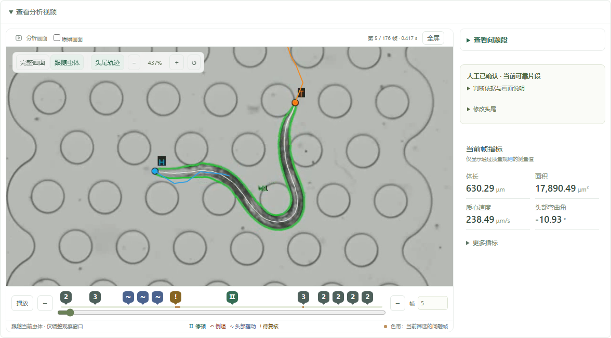
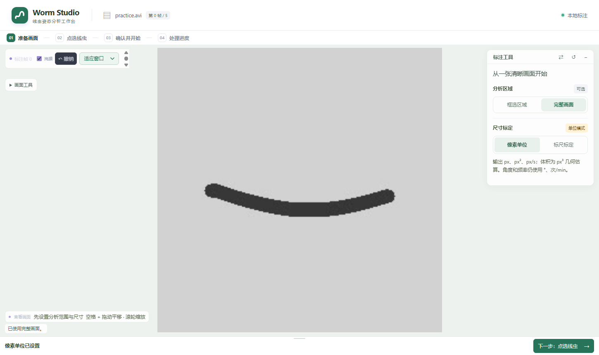
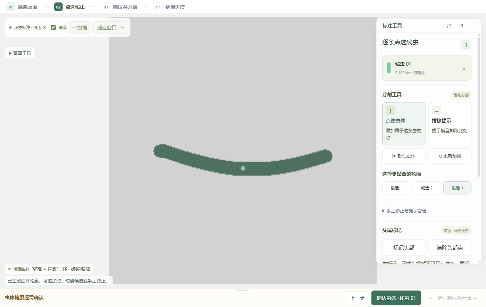
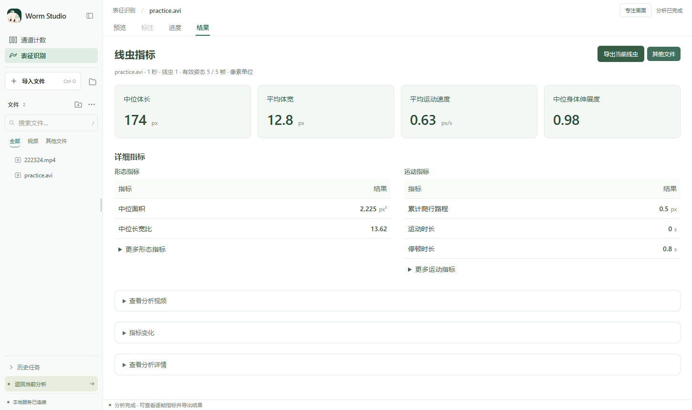

  

<h1 align="center">WormStudio</h1>

<em>🔬 在本机跟踪线虫，逐帧测量体态与运动</em>

  
  
  
  

  <strong><a href="https://github.com/WRtidE/WormStudio/releases/download/v1.1.15/WormStudio-Windows-x64.zip">下载 Windows 在线版</a></strong> ·
  <strong><a href="https://github.com/WRtidE/WormStudio/releases/download/v1.0.3/WormStudio-Mac-arm64.zip">下载 Mac 版</a></strong> ·
  <a href="#用练习视频完成第一次分析">第一次分析</a> ·
  <a href="#windows-可选-gpu-加速">GPU 加速</a>

在视频的一帧里点选虫体，WormStudio 会跟踪它在整段视频中的位置与姿态。你可以回看叠加了轮廓和中线的标注视频，也可以导出逐帧数据，在 Excel 中比较体长、体宽和运动速度。

图中是实验视频 `222324.mp4` 的 **23 号槽**。在 **查看分析视频** 中点 **跟随虫体** 可放大观察，点 **完整画面** 可回看整个芯片。拖动下方帧条，右侧读数会同步更新。图中第 5 帧（0.417 秒）的体长为 **668.35 px**，面积为 **19,870 px²**。本次示例使用像素单位。

## 下载与启动

Windows 当前稳定版为 **v1.1.15**。下载约 **161 MB** 的桌面包，首次打开时由软件准备运行环境和模型。Apple 芯片 Mac 使用 **v1.0.3** 离线包。[Windows 版本说明](https://github.com/WRtidE/WormStudio/releases/tag/v1.1.15) · [下载文件 SHA-256 校验清单](https://github.com/WRtidE/WormStudio/releases/download/v1.1.15/SHA256SUMS.txt)

| 电脑 | 下载 | 如何启动 |
| --- | --- | --- |
| Windows 64 位（x64） | [Windows v1.1.15 在线版，约 161 MB](https://github.com/WRtidE/WormStudio/releases/download/v1.1.15/WormStudio-Windows-x64.zip) | 右键 ZIP，选择“全部解压”，打开 `WormStudio` 文件夹并双击 `WormStudio.exe`，等待首次准备完成。 |
| Apple 芯片 Mac（macOS 14 及以上） | [Mac v1.0.3 桌面包](https://github.com/WRtidE/WormStudio/releases/download/v1.0.3/WormStudio-Mac-arm64.zip) | 解压后将 `WormStudio.app` 拖入“应用程序”。首次启动按包内“先读我.txt”操作，选择“准备并打开”。 |

Windows 首次需要联网下载组件：CPU 约 **1.12 GiB**，NVIDIA GPU 约 **4.14 GiB**，均已包含模型。建议系统盘分别预留 **5 GiB / 12 GiB** 空间。下载中断可继续，准备完成后分析可离线进行。GPU 组件优先从国内镜像下载，失败时自动切换备用源。运行组件和模型由程序自动下载，无需逐一手动选择附件。

## 用练习视频完成第一次分析

首次准备完成后，可用随包的 `practice.avi` 熟悉标注和导出；练习视频只有 5 帧。

1. **选择视频。** 在左侧文件列表中选择 `practice.avi`，点击 **开始标注**。分析自己的视频时，点击 **导入文件** 或将视频拖入工作台，等导入完成后再选中它。
2. **选择区域和单位。** 练习视频选择 **完整画面** 和 **像素单位**，点击 **下一步：点选线虫**。分析实验视频时，如果需要以微米报告体长，选择 **标尺标定**，填入画面中标尺的实际长度（μm），再用 **手动选两端** 点出标尺的两个端点。

   

3. **点选并确认虫体。** 在深色虫体内部点一下，等待轮廓出现。如果漏掉一段，在那一段内部补点。如果圈入了背景，选 **排除提示** 并点击误选的位置。轮廓贴合后，点击底部 **确认虫体**。练习视频可以跳过头端标记。

   

4. **开始分析。** 点击 **下一步：确认并开始**，核对后点 **保存并开始处理**。在 **进度** 页查看跟踪、姿态分析和导出的进展。
5. **回看结果。** 处理完成后打开 **结果 → 查看分析视频**，点击播放或逐帧查看。核对虫体轮廓和中线后，可在同一页导出需要的文件。

## 单虫标注与摆头测量（Windows v1.1.15）

- **先用原图确认轮廓。** 如果虫体旁多圈进了一块槽壁，用擦除工具去掉误选区域。轮廓包进虫身外侧的灰影时，可选 **按原图边缘细化**。固定机位下，活动虫体与培养柱粘连时，可试 **抑制固定背景**，点 **重新预测** 后对照原片检查细尾和静止的虫段。
- **测摆头时先标头端。** 在 **头尾标记** 中按槽选择 **随机抽 2 帧** 或 **随机抽 3 帧**，放大清晰画面后点击头端，模糊帧可以跳过。结果页可在视频旁复核头尾轨迹。单向摆动按次计，完整往返周期频率用 Hz 表示，摆幅用角度表示。缺测会中断周期统计。

本版抽查了 12 段单虫视频。在两种模式均能测量的 22 个配对帧中，默认原图和边缘细化的体长平均绝对百分比误差分别为 3.40% 和 3.37%。在另行核对的 6 个轮廓中，边缘细化使平均体宽误差从 32.66% 降至 13.39%。

下表是两个槽在**共同可观察时段**的复核结果，每格依次为软件值和原图描线参照值。

| 槽位 | 单向摆动次数 | 完整周期频率 | 周期摆幅中位数 |
| --- | ---: | ---: | ---: |
| T6 · 19 号槽 | 26 / 26 次 | 1.43 / 1.57 Hz | 33.4° / 31.2° |
| T10 · 6 号槽 | 11 / 9 次 | 0.86 / 0.71 Hz | 43.8° / 56.2° |

按同方向、相差最多两帧逐次匹配，T6 对上 23 次，T10 对上 8 次。结果仅覆盖这两段视频，原图描线尚缺第二位实验员复核。[测量方法与完整验证记录](docs/VALIDATION.md)

## 导出数据、找回历史结果

打开 **结果** 可查看整段视频的汇总。用 v1.1.15 的发布包运行随附练习视频，CPU 和 NVIDIA 两次验证均得到 **5/5 帧有效姿态**，平均体宽约 **12.8 px**。点击右上角的 **其他文件** 可导出视频、表格或统计图。

| 想做什么 | 选择哪一项 |
| --- | --- |
| 分享或复核识别过程 | **标注视频**，导出带轮廓和中线的 MP4 |
| 在 Excel 中比较每一帧的测量值 | **逐帧指标 CSV** |
| 查看每条虫的汇总指标 | **线虫汇总 CSV** |
| 保存统计图 | 展开 **更多数据与质量记录 → 指标与质心轨迹 PNG**。[查看本次练习导出的统计图](docs/screenshots/phenotype-plots.png) |

指标显示 **“—”** 时，点击指标名称可查看原因和有效数据范围。选择像素单位的任务用 px 表示长度。遇到虫体交叉、遮挡或头尾难以分辨的片段，可逐帧复核。如需测量头部角度，请在清晰帧人工确认头端。

关闭软件后，下次启动可在左侧 **历史任务** 中打开之前的结果。Windows 桌面版可通过 **设置 → 通用 → 工作目录 → 在文件夹中打开** 找到本机文件。分析结果在 `outputs` 中。备份时请保留整个工作目录。如果曾使用 **通过视频路径打开**，还需保留对应的原视频。

v1.0.3 导出的标注视频保留完整画面，逐帧数值显示在播放器右侧。打开带黑色指标条的旧任务，在 **查看分析视频** 中点击 **生成无黑条副本**。保留原视频和任务目录即可复用已有标注。完成后，回放和 **其他文件 → 标注视频** 都会使用新版副本。

## Windows 可选 GPU 加速

在 v1.1.15 在线版中，打开 **设置 → 通用 → 检测 GPU**，根据检测结果选择运行方式。

| 检测结果 | 接下来怎么做 |
| --- | --- |
| 显示显卡型号，并提示工作台已能使用它计算 | 直接开始分析，现有环境已经可以加速。 |
| 检测到兼容的 NVIDIA 显卡，提示工作台当前使用 CPU | 点击 **下载并安装 GPU 加速**，准备完成后重启工作台。当前任务继续使用 CPU。 |
| 没有可用的 NVIDIA 显卡或驱动 | 使用基础包进行 CPU 分析即可。 |

### v1.0.3 离线包

Windows v1.0.3 使用 v1.0.2 的 GPU 组件。使用该旧版时，按以下步骤安装。

1. 将 [GPU 分包 1](https://github.com/WRtidE/WormStudio/releases/download/v1.0.2/WormStudio-GPU-cu128-part1.zip) 和 [GPU 分包 2](https://github.com/WRtidE/WormStudio/releases/download/v1.0.2/WormStudio-GPU-cu128-part2.zip) 下载到**同一个文件夹**，保留原文件名和 ZIP 格式。两份共约 3.12 GiB，软件所在磁盘另预留 10 GiB。
2. 等当前分析完成，点击设置里的 **启用离线加速包**。加速窗口打开后，**退出工作台，保留加速窗口**。
3. 在加速窗口点击 **选择已有离线包…**，选择存放两个 ZIP 的文件夹。看到“GPU 加速已启用”后，重新打开工作台，点击 **检测 GPU** 核对显卡型号。

## 分析更多视频

- 要**依次分析多个视频**，一次导入多个文件，按顺序为每个视频确认区域、单位和虫体，最后点击 **确认虫体并开始顺序处理**。
- 同一画面包含多个培养槽时，先勾选 **按培养槽标注**，分别框选并确认虫体。使用支持全槽导出的版本时，同一原片的所有槽完成后会自动生成一个 MP4。在批次结果页选中该原片的任一槽，点 **导出标注视频** 即可保存。**导出汇总表** 保存指标 CSV。
- 要**统计线虫通过通道的次数**，在左侧切换至 **通道计数**，设置通道数、检测线和两侧边界后点击 **开始计数**。结果支持逐帧回看和导出 Excel。

更详细的标注、批处理和复核操作见[完整使用指南](docs/USER_GUIDE.md)。指标的计算条件见[质量与测量规则](docs/QUALITY_SCHEMA.md)。

## 版本与开发资料

v1.1.15 已通过 GitHub 的源码检查和 Windows 桌面包验证。桌面包验证从公开附件下载并解压软件，用 SAM2 Large 分析五帧练习视频，检查导出的逐帧指标和标注视频。[源码检查结果](https://github.com/WRtidE/WormStudio/actions/runs/45398607469) · [桌面包验证结果](https://github.com/WRtidE/WormStudio/actions/runs/45398611400)

[历次桌面版发布](https://github.com/WRtidE/WormStudio/releases) · [更新记录](CHANGELOG.md) · [验证记录](docs/VALIDATION.md)

需要从源码运行或参与开发，可参阅 [Windows 安装与启动](docs/INSTALL.md)、[Mac 开发指南](docs/MACOS.md)、[代码架构](docs/ARCHITECTURE.md)、[开发与测试](docs/DEVELOPMENT.md)和[发布指南](docs/RELEASE.md)。项目自有代码尚未指定统一开源许可证。第三方依赖及模型的来源和许可见[第三方说明](THIRD_PARTY.md)。

源码开发使用 uv 管理项目内的 `.venv`。首次执行 `uv sync --locked --extra cpu --managed-python`（NVIDIA CUDA 用户将 `cpu` 改为 `cuda`），然后按安装指南准备模型。日常使用 `uv run --no-sync studio.py` 或双击 `start.bat` 启动；测试使用 `uv run --no-sync run_tests.py`。
