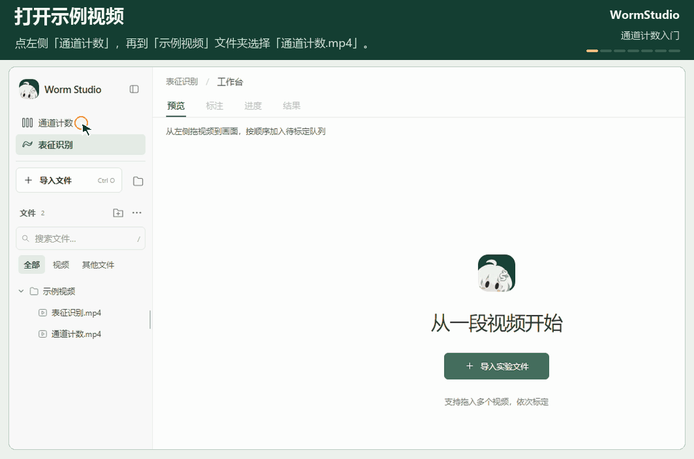
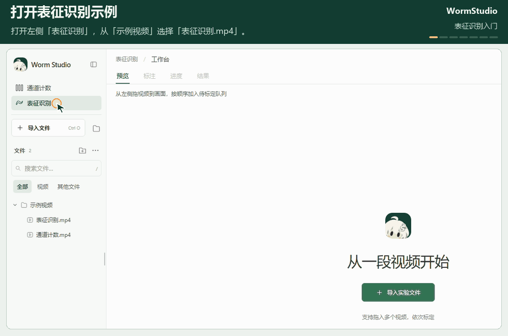

# 使用指南

以下步骤以 Windows v2.0.0 为例。第一次使用，可在左侧选择项目，展开文件栏的 **示例视频**。使用自己的视频时，直接拖入工作台即可。[下载与启动](../README.md#下载与启动)

[通道计数](#通道计数) · [表征识别](#表征识别入门) · [结果与导出](#指标与导出) · [显卡加速](#windows-显卡加速检测)

## 通道计数

1. **设置检测线。** 打开 `通道计数.mp4`，核对通道数。示例有 32 个通道，从右向左编号。上下拖动两条黄虚线，框住检测范围，再将红线拖到要统计的位置。
2. **开始计数。** 点击 **开始计数**。虫体向上越过红线记一次。预览显示当前画面的累计次数，点 **跳到已处理帧** 可查看最新进度。
3. **复核并导出。** 点 **查看结果**，选择一条越线记录，点击前后帧对照。在 **完整视野** 中滚轮放大，按住左键拖动画面，点 **适应画面** 恢复全图。点 **导出全部通道 Excel** 保存明细，也可先选一个通道，再单独导出。

### 多视频批量计数

1. 在 **通道计数** 中一次拖入多个视频或一个文件夹，工作台会打开第一段。
2. 逐段核对通道数、红线和两条黄线，点 **确认并继续** 进入下一段。需要改前一段时，点 **上一个**。
3. 最后一段点 **确认检测线**，再点 **开始批量计数**。每段使用各自确认的线位，按导入顺序处理。
4. 点 **查看队列** 可在当前视频完成后暂停，也可重试失败项。重启后点 **继续未完成项**。完成后点 **导出本批汇总 Excel**，即可比较各视频、各通道的次数。

在 **跨视频通道对照** 中，每行是该视频最近一次完成的计数。点通道次数查看越线记录，点视频名旁的 **移除** 隐藏该组，需要时可从 **已移除** 恢复。

## 表征识别入门

1. **选清晰帧。** 打开 `表征识别.mp4`，停在能看清虫体的一帧，点 **用当前画面开始标注**。使用完整画面，或框出能覆盖虫体整段活动范围的区域。
2. **识别标尺。** 选 **标尺标定**，输入画面上标尺的实际长度（示例为 **500 μm**）。点 **单击识别**，再点彩色标尺横线的中间，核对两个端点。识别有误可选 **手动选两端**。画面没有可靠标尺时，选 **像素单位**。
3. **确认虫体。** 点 **下一步：点选线虫**，再点虫体内部。漏选的地方可补点，多选的背景可用 **排除提示** 去掉。轮廓贴合后点 **确认虫体**。
4. **标记头部。** 点 **标记头部**，再点你能辨认的头端。第一条虫会显示 **H1**。头尾难辨时可跳过，换到清晰帧再确认。
5. **处理并回看。** 点 **下一步：确认并开始 → 保存并开始处理**。完成后打开 **结果 → 查看分析视频**，逐帧检查轮廓和中线。

### 一次拖入多个视频并依次标定

一次拖入多个视频，或从左侧文件列表把已有视频拖到中央预览。检查顺序后点 **按顺序标注**，逐段设置区域、标尺并确认虫体。每段点 **确认虫体并标定下一个**，最后一段点 **确认虫体并开始顺序处理**。中断后，可在队列点 **继续待处理任务**。

同一视频有多个培养槽时，先勾选 **按培养槽标注**，逐槽框选并确认虫体。该视频的全部槽完成后，可在批次结果中选任意一个槽，点 **导出标注视频** 保存合并的 MP4。

## 指标与导出

| 想保存什么 | 在哪里操作 |
| --- | --- |
| 各通道次数与逐条越线记录 | **通道计数 → 结果复核 → 导出全部通道 Excel** |
| 一批视频的计数对照 | 在批量队列点 **导出本批汇总 Excel** |
| 逐帧体态和运动指标 | 在表征识别结果的 **其他文件** 中选 **逐帧指标 CSV** |
| 带轮廓和中线的回放 | 在同一处选 **标注视频**，保存 MP4 |

**头部指标为什么显示“—”？** 该帧缺少可靠的测量条件。A/B 表示头尾方向待定，H?/T? 是自动候选。需要头部指标时，可在 **头尾标记** 中随机抽 2 或 3 帧，在看得清的帧上点击头端。人工确认头端后，该帧还须满足轮廓和姿态要求才能给出正式数值。[测量规则](QUALITY_SCHEMA.md)

## 文件工作区与历史结果

在 Windows 打开 **设置 → 通用**，点“工作目录”旁的 **在文件夹中打开**。通道计数保存在 `outputs/channel-counts/`，表征识别保存在 `outputs/<运行名>/`。通过完整路径打开的视频仍引用原文件，备份时请一并保留。

- **再看一次结果。** 选中视频，展开侧栏的 **计数记录** 或 **历史任务**。计数记录可以向左拖动，再点 **删除** 从列表移除。原视频和保存的结果仍在磁盘上。
- **继续上次标注。** 草稿自动保存在本机。重新打开同一视频的同一帧即可恢复。如果出现保存失败提示，点 **保存草稿** 重试。

## Windows 显卡加速检测

- **表征识别（Windows v2.0.0）**　默认可用 CPU。要使用 NVIDIA 显卡，打开 **设置 → 通用 → 检测 GPU**。若提示可升级，点 **下载并安装 GPU 加速**，准备完成后重启。GPU 组件约 4.14 GiB，建议预留 12 GiB 磁盘空间。
- **通道计数**　Windows v2.0.0 会自动选择设备。有可用的 OpenCL 显卡时，软件用 GPU 处理背景和前景掩膜，进度栏显示 **GPU**。其他电脑自动使用 **CPU**。显卡中途出错时会自动用 CPU 从头重算，并更新同一条计数记录。
